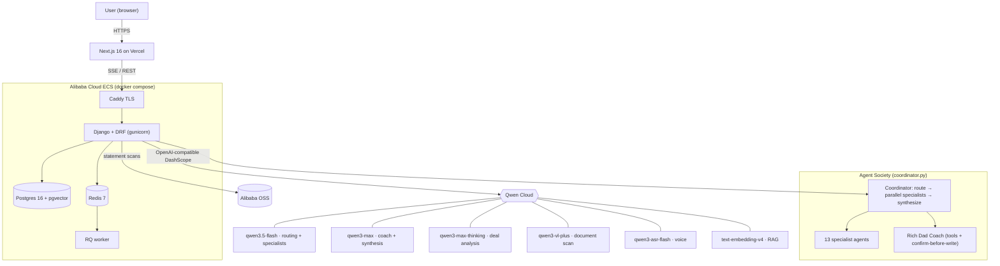

# NairaSage — an AI financial co-pilot for Nigeria

> **Global AI Hackathon Series with Qwen Cloud — Track: Agent Society.**
> A society of 13 specialist financial agents, coordinated to decompose each
> question, work in parallel, and synthesize one grounded answer — powered
> end-to-end by **Qwen models on Qwen Cloud**, deployed on **Alibaba Cloud**.

NairaSage is built for Nigerian financial reality — 20%+ inflation, Naira
volatility, NGX, CBN policy, FIRS/PAYE taxes — where generic Western finance
apps don't fit. It pairs a multi-agent coordinator with the Rich Dad (Kiyosaki)
coaching framework, persistent "Financial DNA" memory, multimodal document
scanning, and visible-reasoning deal analysis.

**Powered by Qwen on Alibaba Cloud:**

| Capability | Qwen model | Where |
|---|---|---|
| Routing + 12 specialist agents | `qwen3.5-flash` | [`core/llm_factory.py`](backend/core/llm_factory.py) |
| Rich Dad Coach + answer synthesis | `qwen3-max` | [`core/llm_factory.py`](backend/core/llm_factory.py) |
| Deal deep-analysis (visible reasoning) | `qwen3-max-thinking` | [`apps/wealth/deal_analysis.py`](backend/apps/wealth/deal_analysis.py) |
| Bank-statement / receipt scan | `qwen3-vl-plus` | [`apps/wealth/document_scan.py`](backend/apps/wealth/document_scan.py) |
| Voice transcription | `qwen3-asr-flash` | [`apps/wealth/voice_transcribe.py`](backend/apps/wealth/voice_transcribe.py) |
| RAG embeddings (pgvector) | `text-embedding-v4` | [`core/embeddings_factory.py`](backend/core/embeddings_factory.py) |

All Qwen calls go through the OpenAI-compatible DashScope endpoint.
**Alibaba Cloud integration proof:** [`backend/integrations/alibaba_cloud.py`](backend/integrations/alibaba_cloud.py)
(live DashScope + OSS health checks). What was built during the hackathon:
[`docs/HACKATHON.md`](docs/HACKATHON.md). Efficiency vs single-agent:
[`docs/BENCHMARK.md`](docs/BENCHMARK.md).

## Architecture



## Quick start (development)

### Backend

```bash
cd backend
python -m venv venv
# Windows: venv\Scripts\activate
pip install -r requirements.txt
cp .env.example .env   # edit values; see Environment below
python manage.py migrate
python manage.py runserver
```

`manage.py` uses `config.settings.development` by default.

### Redis

Cache, health checks, and RQ workers expect Redis at `REDIS_URL` (default `redis://127.0.0.1:6379/0`).

### RQ worker (routing-weight updates after chat feedback)

```bash
cd backend
python manage.py rqworker default high low
```

### Frontend

```bash
cd frontend
npm install
# optional: .env.local with NEXT_PUBLIC_API_URL=http://localhost:8000
npm run dev
```

### Deploying the frontend (Vercel / similar)

- Set the project **root directory** to **`frontend`** (not the monorepo root). If the root is wrong, only `/` may work and routes like `/login` or `/register` can return **404**.
- Set `NEXT_PUBLIC_API_URL` to your production API origin (HTTPS).
- Optional: `NEXT_PUBLIC_POSTHOG_KEY` and `NEXT_PUBLIC_POSTHOG_HOST` for analytics ([frontend/.env.example](frontend/.env.example)).
- Do not set `basePath` unless you intentionally serve the app under a subpath.
- After `npm run build`, `node scripts/check-next-routes.mjs` verifies critical routes exist in the build manifest (also run in CI).
- Next.js does not allow duplicate `app/login` and `app/(auth)/login` (same URL). Auth routes live only under `app/(auth)/…`.
- **Dashboard gate (MVP):** `frontend/middleware.ts` allows `/dashboard/*` only when the **`ns_session=1`** cookie is present. The client sets this cookie when tokens are stored and clears it on sign-out (`frontend/lib/auth.ts`). This is an interim layer until httpOnly cookie auth; JWT in `localStorage` alone is not visible to middleware.
- **shadcn/ui forms:** Not required for a minimal build; migrate goals/debt/tax screens to shared shadcn form primitives when you add the component library to the project.

## Environment matrix

| Variable | Required (prod) | Notes |
|----------|-----------------|--------|
| `SECRET_KEY` | Yes when `DEBUG=False` | No default in production |
| `DEBUG` | Set `False` | |
| `ALLOWED_HOSTS` | Yes | Comma-separated or JSON list via django-environ |
| `DATABASE_URL` | Yes | Postgres URL; omit only for local SQLite |
| `REDIS_URL` | Yes | e.g. `redis://host:6379/0` |
| `CORS_ALLOWED_ORIGINS` | Yes | Frontend origins, e.g. `https://app.example.com` |
| `CSRF_TRUSTED_ORIGINS` | If cookies/admin cross-origin | Often same as CORS origins |
| `FRONTEND_URL` | For email links | Password reset, email verification |
| `PAYSTACK_SECRET_KEY` | Billing | Webhook signature + server API |
| `PAYSTACK_PUBLIC_KEY` | Billing UI | Exposed to frontend via API if needed |
| `PAYSTACK_PLAN_STARTER`, `PAYSTACK_PLAN_PRO` | Subscriptions | Paystack plan codes |
| `DASHSCOPE_API_KEY` | Yes when `LLM_PROVIDER=qwen` | Qwen Cloud key (`sk-...`) from Model Studio → API-KEY. Redeem your hackathon coupon first to fund it. |
| `DASHSCOPE_BASE_URL` | Optional | Defaults to the international DashScope endpoint |
| `QWEN_MODEL` / `QWEN_SYNTHESIS_MODEL` / `QWEN_COACH_MODEL` / `QWEN_THINKING_MODEL` / `QWEN_VL_MODEL` / `QWEN_ASR_MODEL` / `QWEN_EMBED_MODEL` | Optional | Per-tier model overrides; sensible defaults in [`backend/.env.example`](backend/.env.example) |
| `MISTRAL_API_KEY` / `OPENAI_API_KEY` / `GROQ_API_KEY` / `GEMINI_API_KEY` | One per `LLM_PROVIDER` | Fallback providers; see `backend/core/llm_factory.py` |
| `LLM_PROVIDER` | | `qwen` (hackathon), `mistral` (default), `openai`, `groq`, or `gemini` |
| `EMBEDDINGS_PROVIDER` | Optional | Defaults to `LLM_PROVIDER`; `qwen` uses `text-embedding-v4` |
| `AWS_S3_ENDPOINT_URL` | Alibaba OSS | S3-compatible OSS endpoint, e.g. `https://oss-eu-central-1.aliyuncs.com` |
| `CADDY_DOMAIN` | ECS TLS | Domain for the Caddy service in docker-compose |
| `NEXT_PUBLIC_VOICE_MODE` | Optional (frontend) | `qwen` (default, push-to-talk) or `assemblyai` (streaming) |
| `SENTRY_DSN` | Optional | Set in production settings |
| `EMAIL_*` | Production mail | `EMAIL_BACKEND`, SMTP host/user/password |
| `AWS_*` | Optional | S3/R2 media when configured in production |
| `ASSEMBLYAI_API_KEY` | Optional | Real-time voice STT; tokens minted at `GET /api/wealth/voice/token/` (never expose the key in the browser) |

Copy [backend/.env.example](backend/.env.example) and extend with any keys above.

## Production deployment (Alibaba Cloud ECS)

The full backend stack — Django, Postgres+pgvector, Redis, RQ worker, and Caddy
TLS — runs from [docker-compose.yml](docker-compose.yml) on a single ECS
instance. Step-by-step runbook: [`docs/DEPLOY_ALIBABA.md`](docs/DEPLOY_ALIBABA.md).

- Set `DJANGO_SETTINGS_MODULE=config.settings.production` (see [backend/config/wsgi.py](backend/config/wsgi.py)).
- The DB image is `pgvector/pgvector:pg16` — the knowledge app's RAG needs the `vector` extension.
- `python manage.py collectstatic` before serving static files (WhiteNoise serves them).
- After deploy, re-embed the corpus on Qwen: `python manage.py ingest_books --flush`.
- Verify the Alibaba integration: `python -m integrations.alibaba_cloud` (from `backend/`).
- Frontend stays on Vercel; point `NEXT_PUBLIC_API_URL` at the ECS HTTPS origin.

## Docker

```bash
docker compose up --build
```

Adjust `REDIS_URL` / `DATABASE_URL` in compose environment if using host Redis instead of the `redis` service.

## Testing & CI

- Backend: `cd backend && python manage.py test`
- CI: `.github/workflows/ci.yml`
